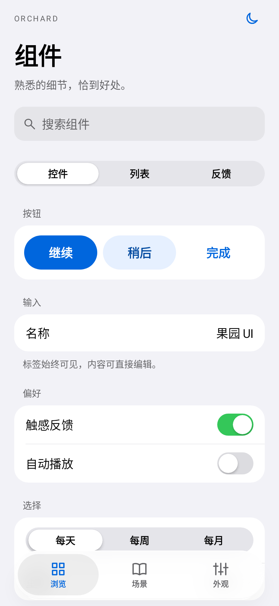
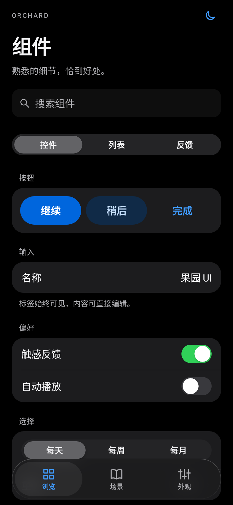
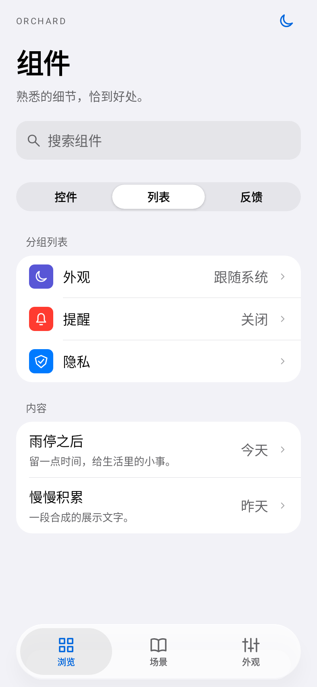
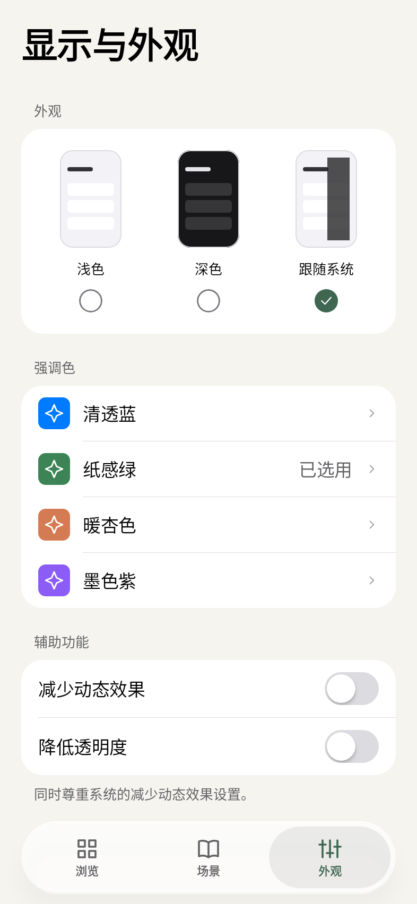
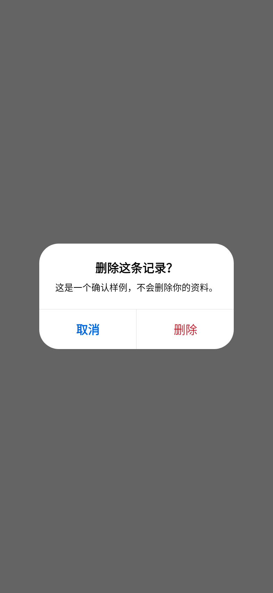
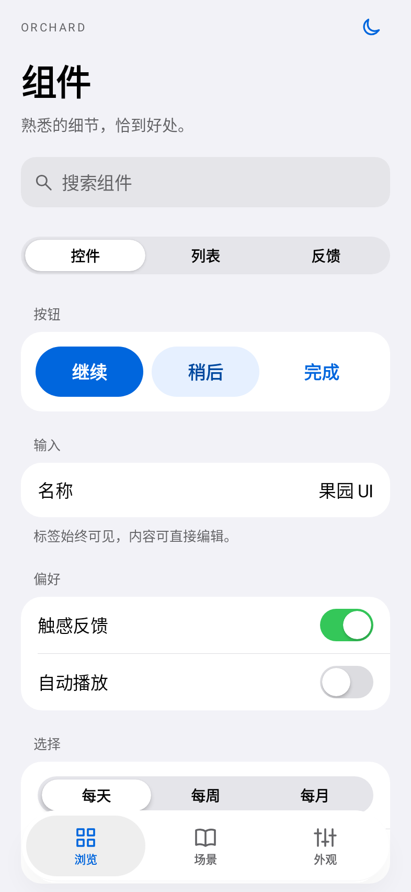
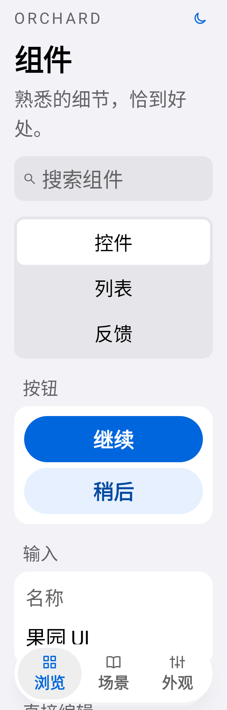
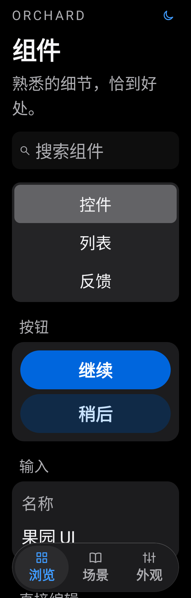

# 0.2 · 新版实际界面

本批按苹果控件的形状与布局重做，具体规则见 [Apple视觉基线](../APPLE_VISUALS.md)。以下为修改后实际运行的 Compose 界面，Robolectric API35 / Native graphics / Roborazzi 输出，使用合成内容。图片不是概念图；尚未进行实体手机验收。原版图像保留在 Git 标签 v0.1.0。

| 组件 · 浅色 | 组件 · 深色 | 分组列表 |
| --- | --- | --- |
|  |  |  |

| 外观选择与强调色 | 居中确认弹窗 | 降低透明度 |
| --- | --- | --- |
|  |  |  |

| 320dp / 200% 浅色 | 320dp / 200% 深色 |
| --- | --- |
|  |  |

大字号下分段改为纵向选择，输入标签与值上下排，导航自动使用实色保证可读。截图不能证明系统栏、IME、TalkBack、动画帧率或真机手势，相关边界见[验证记录](../VERIFICATION.md)。
