# 0.4 · 新版材质与动态流程预览

本库实际运行输出，全部使用原创合成内容。Compose为Robolectric4.17/API35/Native Graphics/Roborazzi1.76.0；Flutter图片为Chromium中运行的发布Web宿主，走标准近似材质，不代表Android Impeller光学效果。源码提交、每个文件的渲染器与SHA256见[manifest](manifest.json)。

| 音乐浅色（Compose） | 随滚动收起（Compose） | 专辑锚点菜单（Compose） |
| --- | --- | --- |
| 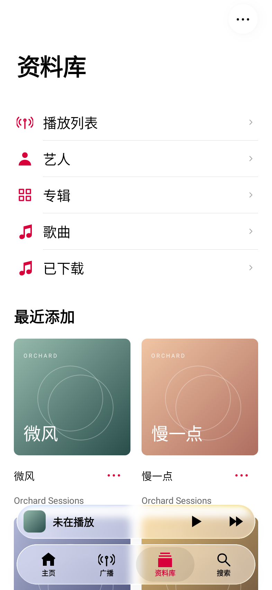 | 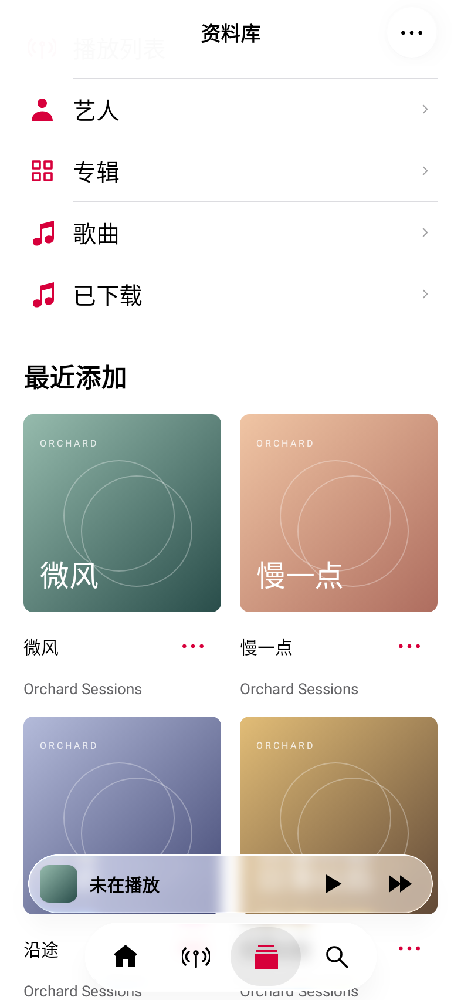 | 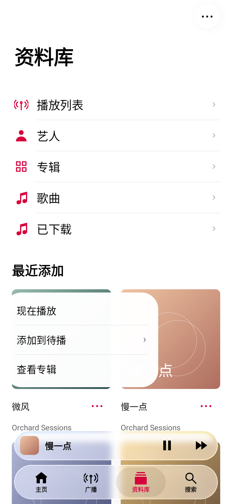 |

| 子菜单（Compose） | 半屏播放器（Compose） | 展开播放器（Compose） |
| --- | --- | --- |
| 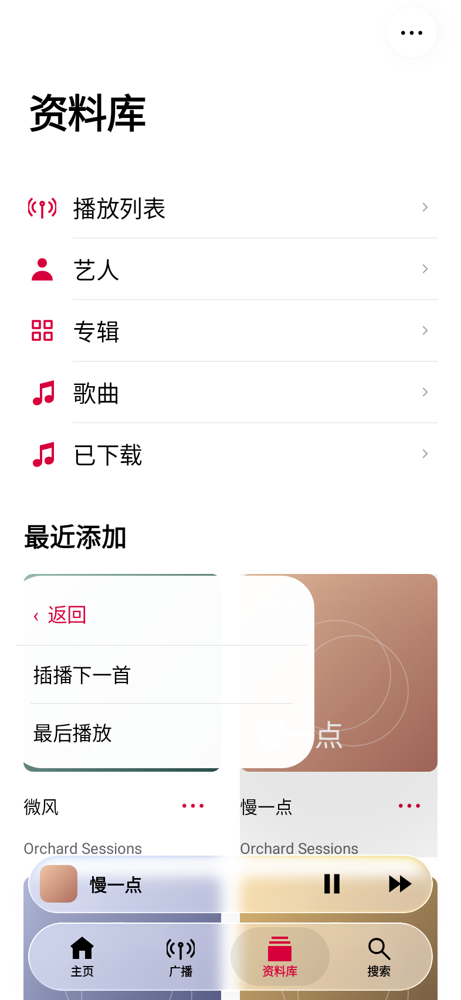 | 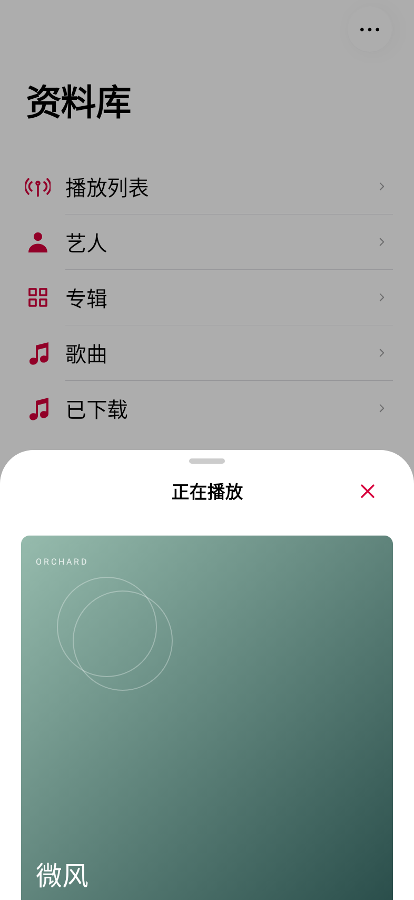 | 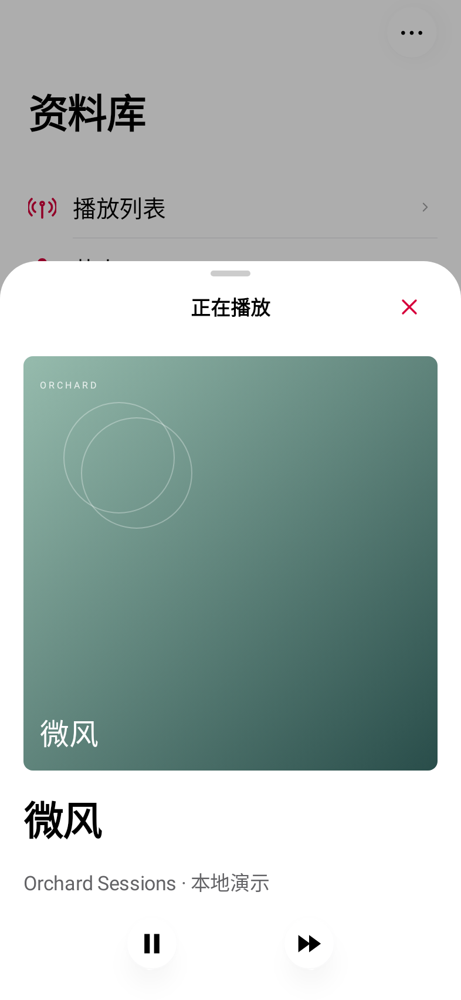 |

[播放Web参考页短录屏](web-liquid-interactions.webm)：实际滚动、锚点子菜单、加入待播、播放器开启和高度切换。该录屏只证明浏览器中的交互过程，不证明Android或iOS真机帧率。

| Flutter浅色 | Flutter深色 | Flutter锚点菜单 |
| --- | --- | --- |
| 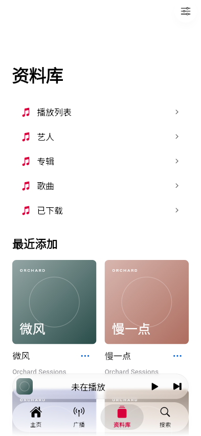 | 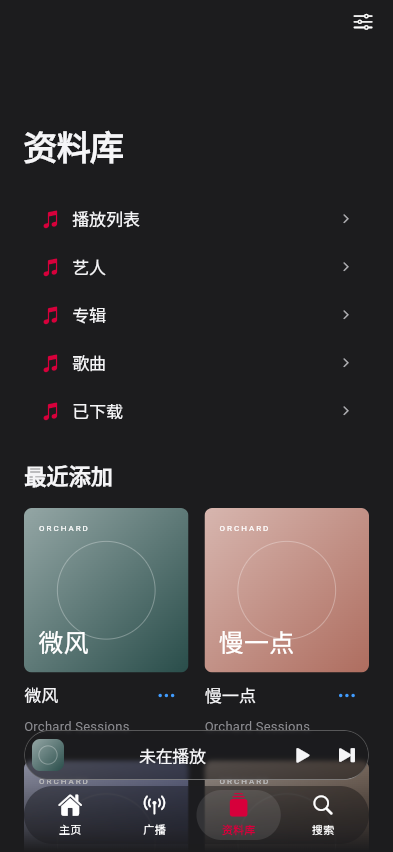 | 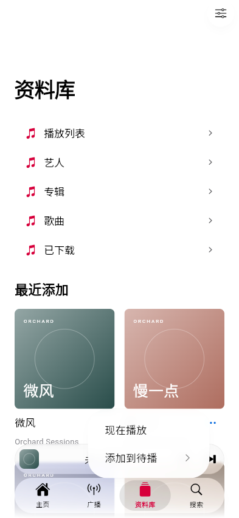 |

[Flutter实际运行短录屏](flutter-liquid-interactions.webm)还包含子菜单待播、Esc关闭菜单与外观切换。

可运行的[Flutter宿主](../../examples/flutter-liquid)和[框架无关Web参考](../../examples/web-reference)均在私有仓库。`python3 tools/build_reference.py`生成单文件HTML，无外部运行依赖；浏览器内的菜单/双高度播放器是近似实现，不声称完整UIKit物理。

## 设置、备忘录与深色

| 设置 | 备忘录 | 音乐资料库 |
| --- | --- | --- |
| 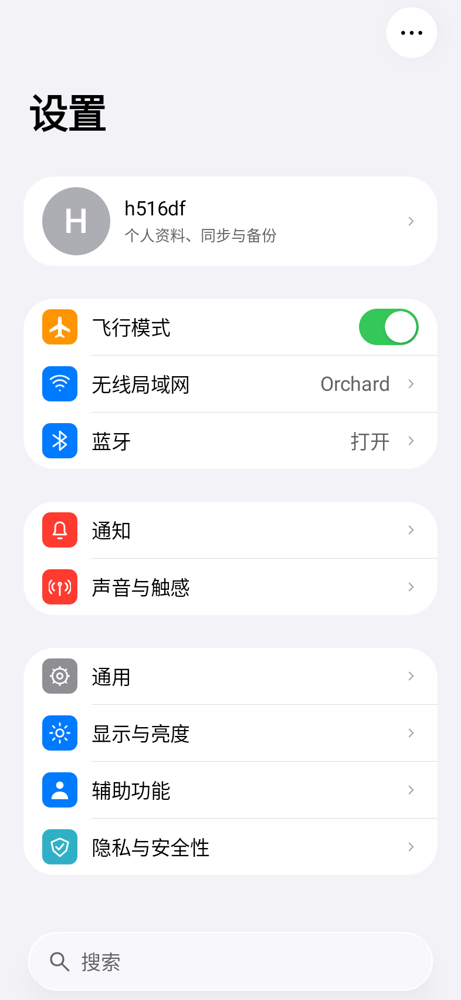 | 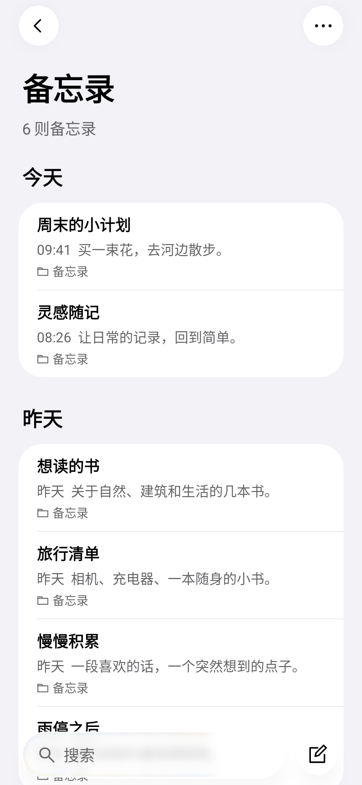 |  |
| 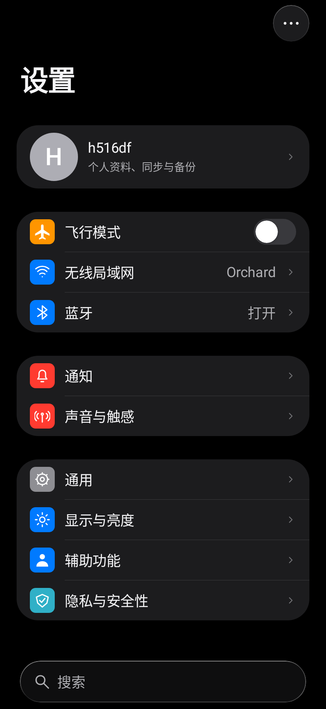 | 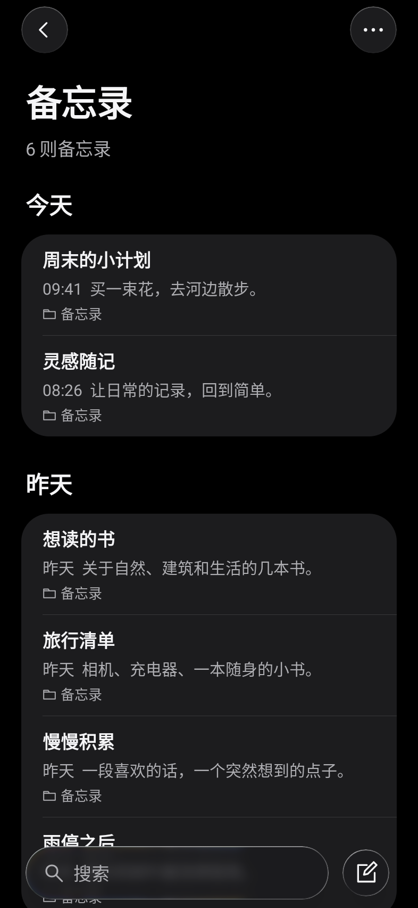 | 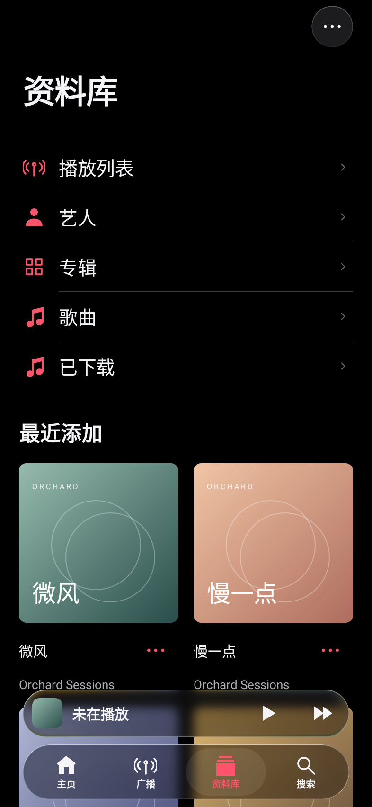 |

| 显示与亮度 | 笔记编辑 | 滚动后的导航 |
| --- | --- | --- |
| 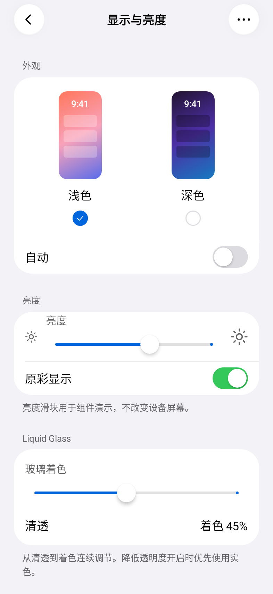 |  | 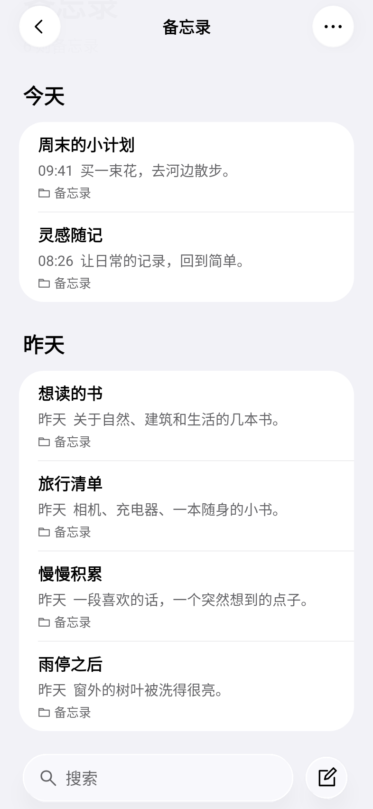 |

| 320dp / 200% 设置 | 320dp / 200% 备忘录 | 控件深色 |
| --- | --- | --- |
| 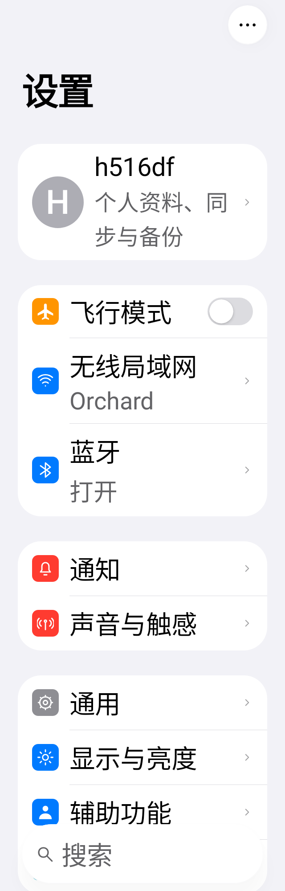 | 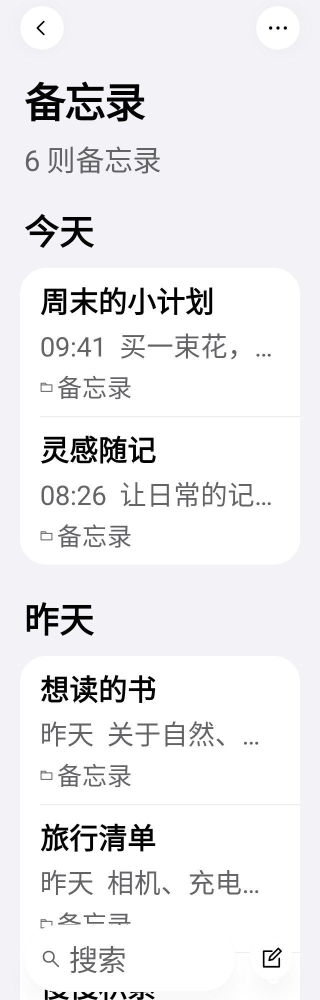 |  |

截图不能证明IME、TalkBack、预测性返回、系统栏、功耗或实体设备动画流畅度；未取得用户视觉验收。官方资料与差异见[材质接入](../LIQUID_GLASS.md)，检查和产物归属见[验证记录](../VERIFICATION.md)。旧版画面保留在v0.1/v0.2/v0.3 Git标签。
